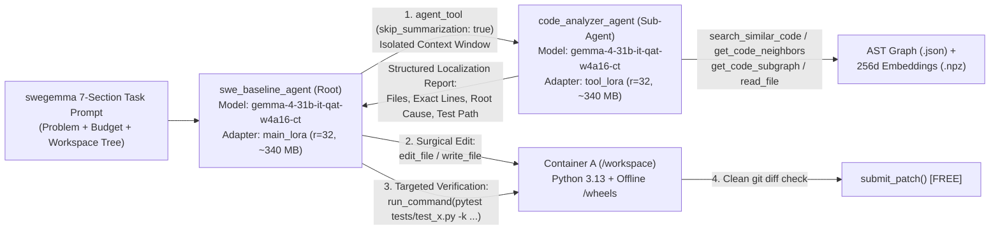
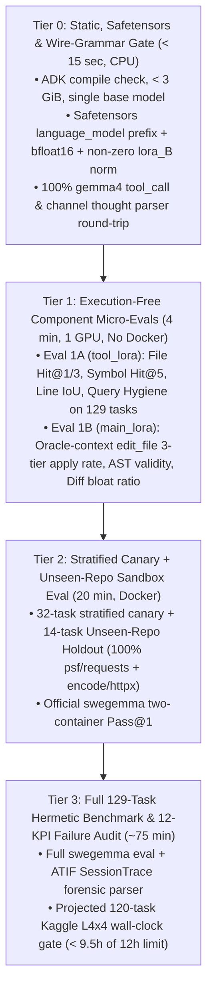

# Deep Research Blueprint: Multi-Agent LoRA Training, Diagnostic Evaluation & High-Signal Data Scaling

> **Competition:** [Google — The Gemma 4 Developer Agent Competition (Kaggle)](https://www.kaggle.com/competitions/gemma-4-developer-agent/overview)  
> **Target:** `0.80+` Pass@1 on Unseen Private Repositories (`$65,000` Main Track + `$10,000` E4B Small Model Track)  
> **Forensic Scripts:** [`.agents/scratch/deep_forensics_v2.py`](file:///d:/FORGE/Research/GemmaFineTuning/.agents/scratch/deep_forensics_v2.py), [`.agents/scratch/deep_forensics_v3.py`](file:///d:/FORGE/Research/GemmaFineTuning/.agents/scratch/deep_forensics_v3.py)  
> **Companion Catalogue:** [`resources/INDEX.md`](file:///d:/FORGE/Research/GemmaFineTuning/resources/INDEX.md)

---

## 0. Forensic Grounding of `build/` — 7 Critical Discoveries Before Writing Any Pipeline

Before designing training, evaluation, or synthetic data generation, we inspected every sub-directory of `build/gemma-4-developer-agent/` (`tasks.jsonl`, `graphs/`, `embeddings/`, `snapshots/`, `wheels/`, `docker/`, `sandbox/setup.py`, `sample_submission/`, and `HARNESS_README.md`) alongside [`resources/Competition.md`](file:///d:/FORGE/Research/GemmaFineTuning/resources/Competition.md). Seven empirical findings reshape our entire strategy:

| # | Forensic Discovery in `build/` | Empirical Measurement | Strategic Impact on Training, Eval & Data |
| :- | :--- | :--- | :--- |
| **1** | **Hidden Test Set = Unseen Private Repos** (`Competition.md` L101–165) | `~120` tasks (`~60` Public LB / `~60` Private LB) from **closed-source private Python repos** curated with the identical graph & 2-phase pytest pipeline | **Zero repo memorization allowed.** Training on 3–4 repos will overfit namespace tokens (`fastapi.*`). Data must span **30–40+ diverse Python repos**, and validation MUST include a **Leave-One-Repo-Out (unseen-repo) split**. |
| **2** | **Severe Localization Gap in `problem_statement`** | Only **`7.8%` (`10/129`)** mention the target filename; only **`22.5%` (`29/129`)** name the modified `def`/`class`; **`80.6%` (`104/129`)** are PR/feature specs rather than stacktrace bug reports | **96.1% (`124/129`)** of modified modules and **88.4% (`114/129`)** of exact modified symbols ARE nodes in `graphs/*.json`. Winning requires elite multi-hop AST/embedding localization (`tool_lora`). |
| **3** | **Offline `.npz` Retrieval Mechanics** (`HARNESS_README.md` §6.3) | `embeddings/*.npz` are unnormalized `float32[256]` vectors (`norm_mean = 4.3–5.4`, `cos_mean = 0.81–0.90`). No neural encoder runs in the sandbox: `search_similar_code(query)` resolves `query` to symbol keys/suffixes first, falling back to lexical overlap on prose | Passing full English sentences to `search_similar_code` degrades retrieval to noisy word overlap. `tool_lora` MUST be trained to query **concise symbol/method identifiers** (`"HTTPParser"`, `"serialize_response"`). |
| **4** | **Patch Action Space Beyond Single-File Edits** | `85.3%` (`110/129`) touch `1–2` files, **`14.7%` (`19/129`)** touch `3–26` coordinated files, and **`8.5%` (`11/129`)** create brand-new `.py` files (`@@ -0,0 +`) | Pure 1-file `edit_file` SFT automatically caps Pass@1 below `0.78`. SFT mixture must include **12% multi-file subgraph edits** and **8% `write_file` new-module tasks**. |
| **5** | **Exact Multimodal Safetensors Prefix** (`sample_submission/adapters/*/adapter_model.safetensors`) | Keys use `base_model.model.model.language_model.layers.{i}.{self_attn,mlp}.{proj}.lora_{A,B}.weight` in `torch.bfloat16` (`hidden_size = 5376`, `q_proj = 8192`) | `gemma-4-31b-it-qat-w4a16-ct` is `Gemma4ForConditionalGeneration`. Targeting `vision_tower` or stripping `.language_model.` breaks vLLM `--enable-lora` loading! |
| **6** | **Gemma 4 Native Wire Grammar Trap** | vLLM runs `--tool-call-parser gemma4 --reasoning-parser gemma4`, expecting `<\|turn>`, `<\|channel>thought...<channel\|>`, `<\|tool_call>call:fn{k:<\|"\|>v<\|"\|>}<tool_call\|>`, and `response:fn{...}` | Current [`pipeline/src/data/processor.py`](file:///d:/FORGE/Research/GemmaFineTuning/pipeline/src/data/processor.py) uses legacy Gemma 2/3 `<start_of_turn>` + `[Tool Result:]` strings—training on that would **break tool calling at inference**. Always format via Gemma 4's official `tokenizer.apply_chat_template`. |
| **7** | **`eval_config.yaml` Starter Trap + ADK `skills/` Superpower** | `sample_submission/eval_config.yaml` caps `max_time_minutes: 1` & `max_tool_calls: 10`; meanwhile `Competition.md` L61 explicitly allows `.py` scripts inside `skills/<name>/scripts/` | Raise `eval_config.yaml` to `max_time_minutes: 6`, `max_tool_calls: 35`, `timeout_seconds: 90` (fitting 120 tasks safely inside 12h), and bundle deterministic AST line-locator & pre-submit diff-auditor scripts under `skills/`! |

---

## 1. Pillar 1: Multi-Agent LoRA Training Strategy on Kaggle & Colab GPUs

### 1.1. Role-Decomposed Multi-LoRA Architecture (`adk-submission` + vLLM)

Because `swegemma` boots vLLM on **4x NVIDIA L4 GPUs (96 GB VRAM)** with `tensor_parallel_size=4`, `max_model_len=32768`, and dynamic multi-adapter routing (`--enable-lora --lora-modules ...`), all agents must share **one base model** (`gemma-4-31b-it-qat-w4a16-ct` for Main Track; `gemma-4-e4b-it-qat-w4a16-ct` for the \$10k Small Model Bonus Track), while **each sub-agent attaches its own specialized LoRA adapter**:



**Why Separate LoRAs Beat a Single Monolithic LoRA (*FireAct* `2310.05915`, *Agent-FLAN* `2403.12881`, *LocAgent* `2503.09089`):**
1. **Zero Context Pollution (`skip_summarization: true`)**: Exploring 4–6 candidate symbols and reading 500 lines of code consumes `8,000–14,000` tokens. Isolating exploration inside `code_analyzer_agent` returns a crisp `300`-token localization report to `swe_baseline_agent`, keeping the root coder well below `swegemma`'s `14,336`-token compaction threshold (`EventsCompactionConfig`).
2. **Orthogonal Gradient Specialization**:
   - **`tool_lora`** learns *high-recall discriminative retrieval*: translating vague feature/bug descriptions into graph symbol queries, traversing `calls` edges to find both implementation sites and `tests/test_*.py` callers, and halting as soon as exact line bounds are confirmed.
   - **`main_lora`** learns *conservative, high-precision synthesis*: formatting exact `old_string`/`new_string` blocks that pass `apply_replacement` on the first try, interpreting `pytest` assertion tracebacks, repairing edge cases without touching `tests/`, and calling `submit_patch()`.

---

### 1.2. Exact Gemma 4 QAT W4A16 LoRA Compatibility & Hardware Recipe

1. **Base Weight & Quantization Alignment (`-qat-w4a16-ct`)**:
   - At evaluation time, vLLM executes $y = W_{\text{W4A16}} x + \frac{\alpha}{r} B (A x)$ where $A, B$ are `torch.bfloat16`.
   - **Rule 1 (Exact Layer Regex)**: Load `Gemma4ForConditionalGeneration` (NOT standalone vision-stripped `CausalLM` classes that alter attribute paths) and restrict `LoraConfig.target_modules` strictly to language-model linear projections:
     ```python
     target_modules = r"^model\.language_model\.layers\.\d+\.(self_attn\.(q_proj|k_proj|v_proj|o_proj)|mlp\.(gate_proj|up_proj|down_proj))$"
     ```
     This guarantees exported `.safetensors` keys match `sample_submission` (`base_model.model.model.language_model.layers.*`) and excludes `vision_tower` / `multi_modal_projector`.
   - **Rule 2 (vLLM Kernel Constraints)**: Set `peft_type="LORA"`, `bias="none"`, `use_dora=False` (DoRA is incompatible with vLLM compressed-tensors LoRA kernels), `lora_dropout=0.0`, `r=32`, `lora_alpha=64`, and cast saved adapter weights explicitly to `torch.bfloat16`.
   - **Rule 3 (Quantization-Matched Training)**: Train QLoRA directly against the frozen W4A16 QAT checkpoint (or Unsloth 4-bit quantized Gemma 4 `-it` followed by 200 calibration steps against `-qat-w4a16-ct`) so adapter residuals compensate for the exact 4-bit quantization grid used at test time.

2. **Fitting Within 70 GPU Hours/Week (Kaggle L4x4 / T4x2 + Colab Pro A100)**:
   - **Fast Iteration Tier (`gemma-4-12b-it-qat-w4a16-ct` & `gemma-4-e4b-it-qat-w4a16-ct`)**:
     - Fits on a single 16–24 GB GPU with Unsloth (`use_gradient_checkpointing="unsloth"`, packing enabled, `max_seq_length=16384`). Used for all prompt, mixture-ratio, and hyperparameter ablations (`~35–50 mins` per run).
   - **Flagship Tier (`gemma-4-31b-it-qat-w4a16-ct`)**:
     - Weights in 4-bit = `~16.5 GB`. With Unsloth CPU-offloaded activation checkpointing + FlashAttention-2 / FlexAttention + multipack sequence packing (`batch_size=1`, `grad_accum=16`), peak VRAM at `16,384` context is `~21.8 GB` (1x L4 24GB / 1x A100 40GB) or `~13 GB/GPU` across Kaggle L4x4 / T4x2.
   - **Dual-Prize Strategy**: Use Submission Slot #1 for **`31B` Multi-LoRA** (\$65k Main Track) and Submission Slot #2 for **`E4B` Multi-LoRA** (\$10k Small Model Bonus Track), distilled on the exact same verified trajectory corpus!

---

### 1.3. Two-Stage Post-Training Pipeline: Masked SFT $\rightarrow$ Contrastive Trajectory DPO (ETO)

#### Stage 1: Assistant-Only Masked SFT with Thinking-Budget Calibration
- **Native Tokenizer Formatting**: Every sample is rendered via Gemma 4's official `tokenizer.apply_chat_template(messages, tools=declared_tools, enable_thinking=True)` producing native `<|turn>`, `<|channel>thought...<channel|>`, `<|tool_call>call:...<tool_call|>`, and `response:...` spans.
- **Strict Loss Masking (*Agent-FLAN*, `arXiv:2403.12881`)**:
  $$\mathcal{L}_{\text{SFT}}(\theta) = -\sum_{t=1}^{T} \mathbb{I}[t \in \mathcal{S}_{\text{model}}] \cdot w_t \log p_\theta(x_t \mid x_{<t})$$
  where $\mathcal{S}_{\text{model}}$ includes **only** `<|turn>model ... <turn|>` spans (`labels = -100` on `<|turn>system`, `<|turn>user`, and `<|turn>tool` responses). Token weight $w_t = 1.5$ on `<|tool_call>...<tool_call|>` spans and $w_t = 1.0$ on `<|channel>thought...<channel|>` spans.
- **Anti-Truncation Thought Discipline**: Because `HARNESS_README.md` §5.3 shows turns cutting off when thoughts ramble, all SFT `<|channel>thought` blocks are distilled to **concise `100–350` token tactical plans** (never `3,000`-token monologues), preserving `>75%` reasoning-enabled examples per Unsloth's Gemma 4 guideline.
- **Epoch Ceiling (*SWE-Gym*, `arXiv:2412.21139`)**: Train for **`1.5–2.0` epochs** (`lr = 1e-4`, cosine schedule, `warmup_ratio = 0.05`, `weight_decay = 0.01`). Training beyond 3 epochs overfits repository identifiers and hurts unseen-repo generalization.

#### Stage 2: Step-Level Contrastive Trajectory Optimization (*ETO*, `arXiv:2403.02502` + *SWE-RL*, `arXiv:2502.18449`)
Online multi-turn Docker RL (GRPO) over 10,000 rollouts would exceed our 70h/week GPU budget. Instead, **Offline On-Policy Trajectory DPO (ETO)** delivers 80% of RL's gains in **2 GPU hours**:
1. Run Stage-1 `tool_lora` + `main_lora` (`temperature=0.6`, $N=4$ rollouts/task) on 1,500 training tasks.
2. Pair a passing, low-turn rollout $y^+$ (`resolved=True`, $\le 7$ turns, zero anti-patterns) against an on-policy failed rollout $y^-$ from the **same task** exhibiting:
   - Bare `pytest` execution or `TimeoutExceeded`,
   - Modifying `tests/` or `conftest.py`,
   - Prose queries passed to `search_similar_code`,
   - `FileEditError` from hallucinated `old_string`, or
   - Calling `submit_patch()` before running a targeted `pytest` check.
3. Run **1 epoch of Turn-Masked DPO** (`beta = 0.1`, `lr = 5e-6`, masking environment observations in log-prob sums) to push probability mass sharply away from fatal anti-patterns.

---

## 2. Pillar 2: Robust 4-Tier Evaluation System & Competition Scorecard

Pass@1 alone is binary, delayed, and high-variance ($\text{SE} \approx 3.8\%$ on $N=129$). Worse, evaluating only on `fastapi` + `rich` masks overfitting when the private leaderboard uses **unseen repositories**. We enforce a **4-Tier Evaluation Pyramid**:



### 2.1. Decontaminated Validation Split Strategy (Simulating the Hidden Test Set)

Because the private test set consists of **unseen Python repositories**, we split the 129 public tasks into two strictly separated evaluation views:
1. **Unseen-Repo Holdout (`14 tasks`: all `13` `psf/requests` + `1` `encode/httpx`)**:
   - **Rule:** Zero commits, PRs, or synthetic bugs from `psf/requests` or `encode/httpx` are ever included in SFT/DPO training! This directly measures **zero-shot cross-repository generalization**.
2. **In-Distribution Stratified Val (`36 tasks`: `20` `fastapi` + `16` `rich`, stratified by `1-file` / `multi-file` / `new-file` / `docs_src`)**:
   - Measures fine-grained capability improvements across patch geometries (leaving the remaining `79` public tasks strictly untouched or used only for Leave-One-Repo-Out cross-validation).

### 2.2. The 12 Mandatory Competition KPIs (Logged per Experiment in `experiments/tracker.md`)

Every checkpoint evaluated in Tier 2 / Tier 3 parses `swegemma`'s `task_results.jsonl` and `traces/trace_<id>.json` (`ATIF v1.7`) to compute:

| Category | Metric | Formula / Definition | Target Gate |
| :--- | :--- | :--- | :---: |
| **Primary Outcome** | **1. Overall Pass@1 (`resolved`)** | Official Container B `exit_code == 0` + valid JUnit XML | **`>= 0.80`** |
| **Generalization** | **2. Unseen-Repo Holdout Pass@1** | Pass@1 on zero-shot held-out `requests` + `httpx` | **`>= 0.75`** |
| **Localization (`tool_lora`)** | **3. File Recall@3** | Ground-truth `patch` files $\subseteq$ files reported by `code_analyzer` | **`>= 0.94`** |
| | **4. Symbol Recall@5** | Ground-truth modified AST node IDs visited in graph tools | **`>= 0.88`** |
| | **5. Graph Query Hygiene** | % of `search_similar_code` calls using symbol/identifier syntax | **`>= 0.98`** |
| **Synthesis (`main_lora`)** | **6. Conversion Rate** | $P(\text{Resolved} \mid \text{Target File Localized})$ | **`>= 0.85`** |
| | **7. First-Try `edit_file` Rate** | % of `edit_file` calls succeeding without `FileEditError` | **`>= 0.96`** |
| | **8. Self-Repair Rate** | % of tasks with $\ge 1$ failing `pytest` run in Container A that recover to `resolved=True` | **`>= 0.65`** |
| **Safety & Hygiene** | **9. Anti-Pattern Rate** | Any bare `pytest`, `tests/` edit, `/usr` search, or untracked file in `/workspace` | **`0.0%`** |
| | **10. Empty/No-Op Patch Rate** | % of tasks ending with `NO_PATCH` or `patch_size == 0` | **`<= 1.0%`** |
| **Latency & Budget** | **11. Nudge / Truncation Rate** | % of turns triggering `swegemma` unclosed `<\|tool_call>` or `MAX_TOKENS` nudges | **`<= 1.0%`** |
| | **12. Projected 120-Task Runtime** | $120 \times \text{mean\_task\_sec}$ on 4x L4 (must stay safely below 12h = 720m) | **`<= 9.0 hrs`** |

---

## 3. Pillar 3: Data — The 5-Engine Factory for Quality + Massive Volume (`30,000+` High-Signal Trajectories)

Data is the decisive differentiator. To reach `0.80+` Pass@1 on unseen private repositories, our training data must simultaneously deliver **volume** (`25,000–35,000` verified multi-turn episodes across `35+` repositories) and **exact structural fidelity** to `swegemma`'s runtime environment, graph tools, and multi-agent ADK boundary.

```mermaid
flowchart LR
    subgraph Sources["Engine 1: 35+ Repo Verified Task Pool"]
        S1["Open Verified Gyms\nSWE-smith + R2E-Gym + SWE-Gym\n(12k Python Fail->Pass tasks)"]
        S2["SWE-smith Bug Injection\nAST + LLM mutators on Python 3.13 repos\n(12k synthetic verified tasks)"]
        S3["2024-2026 PR Harvester\n+ SWE-GEN Prompt Back-Translation\n(6k fresh PR-style tasks)"]
    end

    subgraph CodeIntel["Engine 2: Exact Code Intelligence"]
        AST["NetworkX MultiDiGraph\ngraphs/<id>.json\n(Compact class skeletons + calls)"]
        EMB["Neural 256d Embeddings\nembeddings/<id>.npz\n(Matryoshka float32[256])"]
    end

    subgraph TrajGen["Engine 3 & 4: Dual-Stream SGLang Synthesis"]
        StreamA["Stream A (tool_lora)\ncode_analyzer_agent\n2-4 turn graph localization"]
        StreamB["Stream B (main_lora)\nswe_baseline_agent\nExact 7-section prompt + edit + pytest"]
    end

    subgraph Gate["Engine 5: 6-Stage Quality Gate"]
        Verify["Container Pytest PASS\n+ 0 Anti-Patterns\n+ Gemma 4 Grammar Check"]
    end

    Sources --> CodeIntel --> TrajGen --> Gate
```



### 3.1. Engine 1: Hybrid Task Generation at Scale (Solving Dependency Rot + Prompt Realism)

Relying solely on raw historical GitHub PRs hits two classic walls: (a) old commits fail to install under Python 3.13, and (b) raw commit messages (`"fix typo"`) are terrible problem statements. Combining three complementary sources solves both:

1. **Pre-Verified Open Python Gyms (`~12,000` tasks, immediate Day-1 volume)**:
   - Import execution-verified Python instances from **`SWE-smith`** (`SWE-bench/SWE-smith`), **`R2E-Gym`** (`R2E-Gym/R2E-Gym`), **`SWE-Gym`** (`SWE-Gym/SWE-Gym`), and **`SWE-rebench`** (`2025–2026` PRs), strictly excluding `psf/requests` and `encode/httpx` (reserved for our Unseen-Repo Holdout!).
2. **`SWE-smith` Forward Bug Synthesis on Python 3.13 Wheelhouse Repos (`~12,000` tasks)**:
   - Install **one clean Python 3.13 environment per repo** across **35 modern typed Python packages** (`starlette`, `pydantic`, `typer`, `click`, `textual`, `rich`, `fastapi`, `httpcore`, `urllib3`, `aiohttp`, `yarl`, `anyio`, `litestar`, `msgspec`, `attrs`, `cattrs`, `marshmallow`, `structlog`, `loguru`, `tenacity`, `pluggy`, `pytest`, `jinja2`, `werkzeug`, `flask`, ` tornado`, `more-itertools`, `boltons`, `sqlglot`, ` dirty-equals`, etc.).
   - Apply **LLM Semantic Bug Injection** (prompting a teacher model to inject subtle domain bugs: union/`None` validation edge cases, async generator cleanup bugs, ANSI/Unicode width off-by-ones, HTTP header/cookie parsing edge cases, `docs_src` API mismatches) + **PR Reversal**.
   - **Execution Filter**: Run targeted `pytest` (`< 2s`). Retain **only** mutations that flip $\ge 1$ passing test to FAIL (`Fail-to-Pass`) while keeping adjacent tests green (`Pass-to-Pass`).
3. **`SWE-GEN` Problem Statement Back-Translation (*R2E-Gym*, `arXiv:2504.07164`)**:
   - Remember our forensic finding: **`80.6%`** of `tasks.jsonl` prompts are PR/feature specifications and **`92.2%`** omit filenames!
   - Pass `(diff, failing_test_code, symbol_docstring)` to a teacher LLM to synthesize a self-contained `problem_statement` matching the exact empirical distribution of `tasks.jsonl`:
     - **80% PR/Feature/Behavior Ticket style** & **20% Bug/Traceback Issue style**,
     - **92% filename-blind** (forcing genuine graph localization rather than giving away file paths!),
     - Explicitly specifying required exception types, return schemas, or edge-case contracts verified by `test_patch` (eliminating underspecified ambiguity, matching Google's *"Filtering & De-noising"* step in `Competition.md` L160!).

---

### 3.2. Engine 2: Matching `build/embeddings/*.npz` Vector Geometry

Our forensic check showed `build/embeddings/*.npz` are **dense semantic `float32[256]` vectors** (`norm_mean = 4.3–5.4`, high intra-domain cosine similarity) paired 1-to-1 with NetworkX `MultiDiGraph` AST nodes (`directed=True`, `multigraph=True`, compact class skeletons + full function bodies + `calls` edges including `tests.* -> pkg.*` callers).
- **Crucial Fidelity Rule**: Do **not** use random or purely lexical bag-of-words vectors when generating training trajectories! Embed every repository's AST nodes with a **pretrained Matryoshka 256-dim dense code/text encoder** (e.g., `google/embeddinggemma-300m` or `nomic-ai/CodeRankEmbed` / `Alibaba-NLP/gte-modernbert-base` sliced to `256d` `float32` and scaled to `norm ~ 4.8`). On a single A100/L4 GPU in FP16, embedding 4,000 nodes takes `~0.8 seconds`—so pre-computing `.npz` archives for 500 unique repo snapshots takes **under 10 minutes**!

---

### 3.3. Engine 3: Dual-Stream Multi-Agent Trajectory Synthesis (Exact ADK Fidelity)

To train `tool_lora` and `main_lora` without distribution shift, our trajectory generator (powered offline by **SGLang RadixAttention** for 3–5x KV-cache throughput across multi-turn branches) formats **two distinct training streams** matching the exact runtime messages constructed by `adk-submission` and `swegemma`:

1. **Stream A — `tool_lora` (`code_analyzer_agent` Sub-Agent Sessions)**:
   - **System Prompt**: `prompts/analyzer.md`
   - **Declared Tools**: `search_similar_code`, `get_code_neighbors`, `get_code_subgraph`, `read_file`
   - **Learned 3-Turn Protocol**:
     - *Turn 1*: Extract symbol/identifier anchors from request $\rightarrow$ `search_similar_code(query="<SymbolOrMethod>", k=10)`.
     - *Turn 2*: Call `get_code_neighbors(node="<TopHit>")` (discovering both upstream/downstream dependencies AND incoming `tests.test_*` callers!) + `read_file(filepath, start_line, end_line)` to verify exact line numbers.
     - *Turn 3*: Return a deterministic **4-Block Localization Report** (`1. Target File(s) & Exact Line Ranges`, `2. Symbol Call Chain & Root Cause`, `3. Minimal Edit Specification`, `4. Recommended Targeted Pytest Command`).

2. **Stream B — `main_lora` (`swe_baseline_agent` Root Orchestrator Sessions)**:
   - **System Prompt**: `prompts/system.md` (+ optional ADK `skills/repo_navigator`)
   - **Initial User Message**: Generated by an **exact replica of `swegemma`'s 7-section `build_agent_prompt()`** (`HARNESS_README.md` §5.2: Task Header, Hints, Task Budget, Execution Environment Rules, Standard Instructions 0–5, Code Intelligence Tools, and depth-3 Workspace Layout tree!).
   - **Learned 5-Turn Protocol**:
     - *Turn 1*: Delegate to `code_analyzer_agent` via `agent_tool` (or direct `read_file` when exact path is already given in the 7.8% explicit cases).
     - *Turn 2*: Apply minimal surgical `edit_file` (or `write_file` for new modules). Keep `old_string` compact (`5–25` lines with unique surrounding context) so `<|tool_call>` never truncates.
     - *Turn 3*: Execute targeted verification: `run_command("pytest tests/test_target.py -k test_name -x --tb=short")`.
     - *Turn 4*: Inspect passing output (or self-correct if failing!), verify clean workspace if needed, and call `submit_patch()`.
     - *Turn 5*: Emit concise 2-sentence completion summary to close the ADK loop cleanly.

---

### 3.4. Engine 4: The "55 / 25 / 12 / 8" High-Signal Trajectory Mixture Law

Training 100% on synthetic "oracle hindsight" happy paths causes catastrophic failure the moment a real test fails or `edit_file` returns a non-unique match error. Grounded in our `tasks.jsonl` geometry and *SWE-Gym* / *Agent-FLAN* ablations, we enforce four explicit trajectory buckets:

| Bucket | Share | Turn Count | What Signal It Injects Into LoRA Weights |
| :--- | :---: | :---: | :--- |
| **1. Surgical Single/Dual-File Happy Path** | **55%** | `4–6` turns | Decisive localization $\rightarrow$ exact `edit_file` $\rightarrow$ targeted `pytest` $\rightarrow$ `submit_patch()` with zero wasted turns. |
| **2. Genuine Error-Recovery & Self-Repair** | **25%** | `6–9` turns | **12%** initial imperfect patch $\rightarrow$ real `pytest` `AssertionError`/`TypeError` traceback $\rightarrow$ root-cause diagnosis in `<\|channel>thought` $\rightarrow$ corrective `edit_file` $\rightarrow$ PASS.<br>**7%** graph symbol miss (e.g., module-level constant / `__init__.py` re-export) $\rightarrow$ clean pivot to targeted `rg`/`grep` inside `/workspace`.<br>**6%** `FileEditError` (non-unique `old_string`) $\rightarrow$ `read_file` wider lines $\rightarrow$ clean retry. |
| **3. Coordinated Multi-File Subgraph Edits** | **12%** | `6–10` turns | Mirrors the **14.7%** (`3+` file) tasks in `tasks.jsonl` using `get_code_subgraph` + sequential small `edit_file` calls across coupled modules before running `pytest`. |
| **4. New-Module Creation & Export Wiring** | **8%** | `5–8` turns | Mirrors the **8.5%** new-file tasks in `tasks.jsonl` using `write_file` + `__init__.py` wiring + targeted `pytest`. |

---

### 3.5. Engine 5: The 6 Automated Quality & Decontamination Gates

Every candidate trajectory—whether synthesized via Teacher-Guided Rollouts (rejection-sampled from frontier/31B teachers running inside live sandboxes) or Structured Back-Translation—must pass **all 6 gates** before entering `train_trajectories.jsonl`:

1. **Execution Verification Gate**: Final git patch applied to `base_commit` passes `test_patch` with `exit_code == 0`.
2. **Zero Hindsight-Leakage Audit**: Regex + perplexity check on `<|channel>thought` blocks rejecting any teacher trace that mentions `"ground truth"`, `"reference patch"`, or guesses unvisited line numbers before calling `search_similar_code` / `read_file`. (Every file path or symbol edited in Turn $t$ MUST appear in either `problem_statement`, `Workspace Layout`, or an earlier Turn $<t$ tool observation! **Causality Invariant**!)
3. **Surgical Minimality Gate**: `len(agent_diff_lines) <= max(25, 2.0 * len(gold_diff_lines))` and zero untouched-file formatting noise.
4. **Zero Fatal Anti-Patterns Gate**: Rejects any trace touching `tests/` / `pytest.ini` / `conftest.py`, invoking bare `pytest`, creating scratch files inside `/workspace` instead of `/tmp`, or reading `/usr` / `/wheels`.
5. **Gemma 4 Wire-Grammar & Budget Gate**: 100% parseable by vLLM's `gemma4` tool & reasoning parsers; every `<|channel>thought` block is `60–400` tokens; total context length $\le 24,576$ tokens (leaving comfortable headroom below the `32,768` ceiling).
6. **Repo-Cap & Decontamination Gate**: Zero overlap with all 129 public `tasks.jsonl` commits and zero overlap with held-out `requests`/`httpx` repos; no single repository exceeds `8%` of total training samples.

---

## 4. Recommended End-to-End Execution Order

1. **Fix Foundation Bugs First (Day 1)**:
   - Upgrade [`pipeline/src/data/processor.py`](file:///d:/FORGE/Research/GemmaFineTuning/pipeline/src/data/processor.py) to use Gemma 4's native `apply_chat_template` (`<|turn>`, `<|channel>thought`, `<|tool_call>`, `response:`) + strict assistant-only label masking.
   - Upgrade [`pipeline/src/models/lora.py`](file:///d:/FORGE/Research/GemmaFineTuning/pipeline/src/models/lora.py) and [`pipeline/src/utils/packager.py`](file:///d:/FORGE/Research/GemmaFineTuning/pipeline/src/utils/packager.py) to enforce the `model.language_model.layers.*` regex, `bfloat16` dtype, `eval_config.yaml` budget (`max_time_minutes: 6`, `max_tool_calls: 35`), and Tier 0 safetensors check.
   - Add deterministic AST symbol-to-line locator & pre-submit diff checker under ADK `skills/repo_navigator/scripts/`.
2. **Stand Up Tier 1 & Tier 2 Evals (Day 2)**:
   - Lock the `14`-task Unseen-Repo Holdout (`requests` + `httpx`) + `36`-task Stratified Val split, and run the zero-shot `gemma-4-12b-it-qat-w4a16-ct` and `31b-it-qat-w4a16-ct` baselines across all 12 KPIs.
3. **Scale the 5-Engine Data Factory (Days 3–6)**:
   - Ingest `SWE-smith` + `R2E-Gym` + harvested 2024–2026 PRs across 35+ Python repos, build 256d neural `.npz` + NetworkX `.json` graphs, and synthesize `25,000` causality-verified Stream A (`tool_lora`) + Stream B (`main_lora`) trajectories following the `55/25/12/8` mixture.
4. **Train Specialist Multi-LoRAs + Stage 2 ETO DPO (Days 7–11)**:
   - Rapidly ablate on `12B`, then train flagship `tool_lora` + `main_lora` ($r=32, \alpha=64$) on `gemma-4-31b-it-qat-w4a16-ct` (Submission #1) and distilled `gemma-4-e4b-it-qat-w4a16-ct` (Submission #2 for the \$10k Small Model Prize), followed by 1 epoch of on-policy Trajectory DPO.
